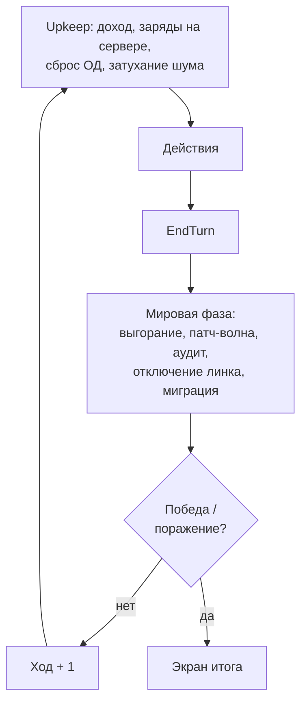

# Правила забега

> Стартовые числа — в `03-BALANCE.md` и `project/data/*.json`. Здесь —
> правила словами. Расхождение с кодом — баг кода или этого документа,
> и его надо чинить сразу.

## 1. Карта

### Гексы

- Pointy-top, ряды со сдвигом. В симуляции — аксиальные координаты
  `Hex(q, r)`, в памяти — плоский массив по offset-координатам odd-r.
  Всё по Red Blob Games, покрыто тестами round-trip.
- Размер одного забега ~20 × 14. Примерно 35–45 % гексов — узлы,
  остальное — воздушный зазор (`Empty`), непроходимый и не захватываемый.

### Типы узлов

| Тип | Роль | Аналог |
|---|---|---|
| `Home` | Домашний ПК. Дешёвый, слабый, много | Крестьянин у дороги |
| `Workstation` | Офисная машина. Средний доход, средняя защита | Шахта |
| `Server` | Доход, компиляция, пополнение зарядов. Цель забега — сервер датацентра | Замок |
| `Router` | Мост между кластерами, единственный проход; сканирует дальше | Мост |
| `IoT` | Умные устройства: почти без защиты и дохода, но их много | Дорога |
| `Controller` | Промышленный контроллер: высокая защита, высокий доход | Золотая шахта |

### Семейства ОС

Эксплойт бьёт только по своей ОС. Разные ОС на карте = необходимость
носить разные эксплойты = решения при компиляции.

| ОС | Где живёт | Характер |
|---|---|---|
| `Kestrel` | Home, Workstation | Массовая. Много эксплойтов, быстро патчится |
| `Bastion` | Server, Router | Серверная. Высокая базовая защита |
| `Mote` | IoT | Встроенная. Дырявая, почти не патчится |
| `Forge` | Controller | Промышленная. Редкие дорогие эксплойты |

### Слои

| Слой | Тип | Смысл | Кто меняет |
|---|---|---|---|
| `Type` | `NodeType` | Тип узла | Генератор |
| `Os` | `Os` | Семейство ОС | Генератор, миграция |
| `Patch` | `int 0..PatchMax` | Защита | Генератор, патч-волны, аудит |
| `Owner` | `int` (−1 нейтрал, 0 игрок) | Владелец | Захват, аудит |
| `Noise` | `float 0..1` | Накопленный шум | Действия, затухание |
| `KnownBy[0]` | `bool` | Снят ли туман | Скан, захват |
| `Name` | `string` | Имя для UI и лога | Генератор |

`Owner` остаётся числом, а не флагом, чтобы `World` и генератор
не переписывать: в v3 владелец либо −1, либо 0.

### Кластеры, роутеры, линки

- Карта — **кластеры** узлов одного профиля: жилой район (Home + IoT),
  офис (Workstation + Server), датацентр (Server с бонусом к Patch),
  завод (Controller + IoT, после прототипа).
- Между кластерами — зазор. Единственный проход — **коридор из
  роутеров**. Daemon стоит только на своих узлах, значит из кластера
  выходит только через захваченный роутер. Роутер под аудитом —
  всё за ним отрезано.
- **Линки** `Link(A, B, Kind)` — двусторонняя связь между не соседними
  гексами; для всех правил концы линка — соседи. `Backbone` роутер ↔
  роутер, `Vpn` офис ↔ офис, `Sneakernet` Home ↔ Workstation. Линк
  виден, если снят туман хотя бы с одного конца. Мировое событие может
  отключить линк на несколько ходов.

### Генерация от сида

Одинаковый сид — одинаковая карта на любой машине. Шаги: центры
кластеров с минимальной дистанцией → профили (старт — жилой, датацентр —
максимально далеко от старта) → заливка BFS радиусом 2 с дырками,
`Patch` = базовый по типу ± 1 → коридоры по остовному дереву плюс 1–2
лишних ребра → линки → имена → валидация (связность, датацентр
достижим, дистанция старт ↔ датацентр ≥ минимума), иначе `seed + 1`.
Генератор v2 остаётся как есть: v3 — это его случай с одним стартом.

## 2. Daemon

- Один на забег. Стоит **только на своём узле**, ходит только по своим.
  Захват расширяет территорию, движение — перемещение внутри неё.
- **3 очка действия** в ход (плюс мутаторы). Не переносятся.
- **Слоты эксплойтов**: базово 3. Слот = `DefId` + заряды.
- **Смерть** — если узел под daemon'ом ушёл под аудит. Забег окончен.
- Нет уровней, опыта, здоровья. Сила daemon'а = его слоты + мутаторы.

## 3. Действия

| Действие | ОД | Цель | Эффект | Шум |
|---|---|---|---|---|
| **Move** | 1 | Соседний свой узел (включая линки) | Перемещение | 0 |
| **Exploit** | 1 | Соседний не свой узел | Захват по правилу §4, тратит заряд | много |
| **Scan** | 1 | — | Снять туман радиусом по типу узла (роутер дальше) | мало |
| **Lurk** | 1 | Узел под daemon'ом | `Noise = 0` | — |
| **Compile** | 0 | Свой сервер под daemon'ом | Эксплойт в свободный слот за Compute | — |
| **EndTurn** | — | — | Конец хода: мировая фаза, затем upkeep | — |

Все действия проверяются одной функцией `Check`: она же даёт UI причину
«нельзя».

## 4. Захват

Daemon применяет слот на **соседний** узел (6 соседей + концы линков):

```text
нужно = Patch[цель]
есть  = Def.Power − PowerPenalty[Def] + PowerBonus[Os цели]
можно, если:
  цель известна (KnownBy), цель не моя
  Os[цель] == Def.TargetOs
  Charges > 0, ActionPoints ≥ 1
  есть ≥ нужно
эффект:
  Owner[цель] = 0
  Charges − 1, ActionPoints − 1
  Noise[цель] += NoisePerUse × NoiseMult
  Exposure[Def] += 1
  туман снимается с цели и её соседей
```

Никаких бросков. `CanCapture` возвращает разбор для UI: нужно, есть,
совпала ли ОС, известна ли цель.

## 5. Эксплойты, компиляция, заряды

- Эксплойт — карточка с числом: `TargetOs`, `Power` (тир 1..5),
  `MaxCharges`, `ComputeCost`, `ExposureLimit`, `NoisePerUse`, `Rarity`.
- **Компиляция** — на своём сервере, daemon стоит на нём: заплатить
  `ComputeCost`, положить в свободный слот с полными зарядами. Слоты
  заняты — сначала выкинуть (`Compile` с указанием слота заменяет его).
- **Заряды** пополняются только на своём сервере: +1 в каждый слот
  в начале хода, если daemon стоит на сервере. Отсюда ритм «сходил —
  вернулся — сходил» и ценность серверов по пути.
- Тиры: T1 берёт `Home`/`IoT`, T2 — офисы и роутеры, T3 — датацентр
  до патчей, T4–T5 — датацентр после патчей и контроллеры. Цена растёт
  квадратично, заряды падают.
- **Зеро-деи** (`Rarity = ZeroDay`) не компилируются: стартовый мутатор
  `zero_day_cache`; дроп с контроллеров — после прототипа.

## 6. Шум и аудит

- Захват и скан добавляют `Noise` на узел. Затухание `× NoiseDecay`
  в начале каждого хода.
- В мировой фазе все узлы с `Noise ≥ NoiseAudit` **вычищаются**:
  владелец → нейтрал, `Patch + 1`, `Noise = 0`. Daemon на таком узле
  убит — забег окончен.
- `Lurk` (1 ОД): `Noise = 0` на узле daemon'а. Тихая игра стоит очков
  действия — это её цена.

Шум — единственная механика, где «быстро» и «тихо» напрямую конфликтуют.

## 7. Экономика Compute

- **Доход** в начале хода: сумма `Yield[Type]` по своим узлам ×
  `ComputeMult`, округление вниз.
- **Расход:** компиляция.
- Без накопительства: старые тиры обесцениваются патчами и выгоранием.
  Сидеть на куче Compute — проигрывать рассвету.

## 8. Ход и мировая фаза



Upkeep идёт в начале хода: игрок сразу видит доход и заряды.

| Событие | Когда | Эффект |
|---|---|---|
| **Burnout** | `Exposure[def] ≥ limit` | `Power − 1` эксплойту навсегда, счётчик в 0, порог × 2 |
| **Patch wave** | По расписанию, K падает с номером хода | Случайная ОС: `Patch + 1` всем узлам этой ОС, кап `PatchMax` |
| **Audit** | Каждый ход | Все узлы с `Noise ≥ NoiseAudit` вычищены (§6) |
| **Link outage** | Редко, с хода N | Случайный линк отключён на `Duration` ходов |
| **Migration** | Редко, с хода M | Нейтральный сервер меняет ОС |

Частота патчей растёт с номером хода — «люди просыпаются». К рассвету
сеть непробиваема, и это намеренно: забег обязан закончиться.

## 9. Победа, поражение, счёт

| Исход | Условие |
|---|---|
| **Победа** | Сервер датацентра захвачен |
| **Поражение** | Daemon вычищен аудитом |
| **Поражение** | Наступил ход `DawnTurn` |

Счёт = `(DawnTurn − Turn) × ScorePerTurnLeft + узлов × ScorePerNode`
при победе; при поражении — только узлы. Множители — данные.

## 10. Мутаторы

Выбираются на старте забега из бюджета `MutatorBudget` очков. Один
и тот же `Modifier` — числа, которые симуляция читает как коэффициенты:
`PowerBonus[Os]`, `NoiseMult`, `ComputeMult`, `ExtraActionPoints`,
`ExtraCharges`, `ExtraSlotLimit`, `ScanRadiusBonus`, `StartingExploit`.
Свёртка: бонусы складываются, множители перемножаются, считается один
раз при создании забега.

После прототипа: мутаторы открываются за забеги (мета), см. `06-PLAN.md`.

## 11. Тест на верность жанру

Сторожевой вопрос: **может ли игрок описать свой ход словами плана?**
«Сканирую роутер, беру его T2, следующим ходом на сервер за зарядами» —
да. Если ход сводится к «кликать всё, что подсвечено» — глубины нет,
чинить данные (цены, шум, расписание патчей), а не добавлять механики.

## 12. Ситуации, ради которых это всё

- Роутер под туманом показывал патч 2, пришёл с T2 — а патч-волна
  подняла его до 3. Очко потрачено, заряд цел. Ждать T3 или искать VPN?
- Один заряд T4 и датацентр в трёх гексах. Между ними роутер с патчем 3.
  Возвращаться на сервер за зарядами — минус четыре хода до рассвета.
- Три захвата подряд в жилом районе: доход вырос, но шум 0.9 на двух
  узлах, один — под ногами. Lurk сейчас или рискнуть и идти дальше?
- Аудит снёс роутер за спиной. Daemon в офисе, сервер там ещё не мой,
  заряды кончаются. Единственный путь — Sneakernet-линк, если он есть.
