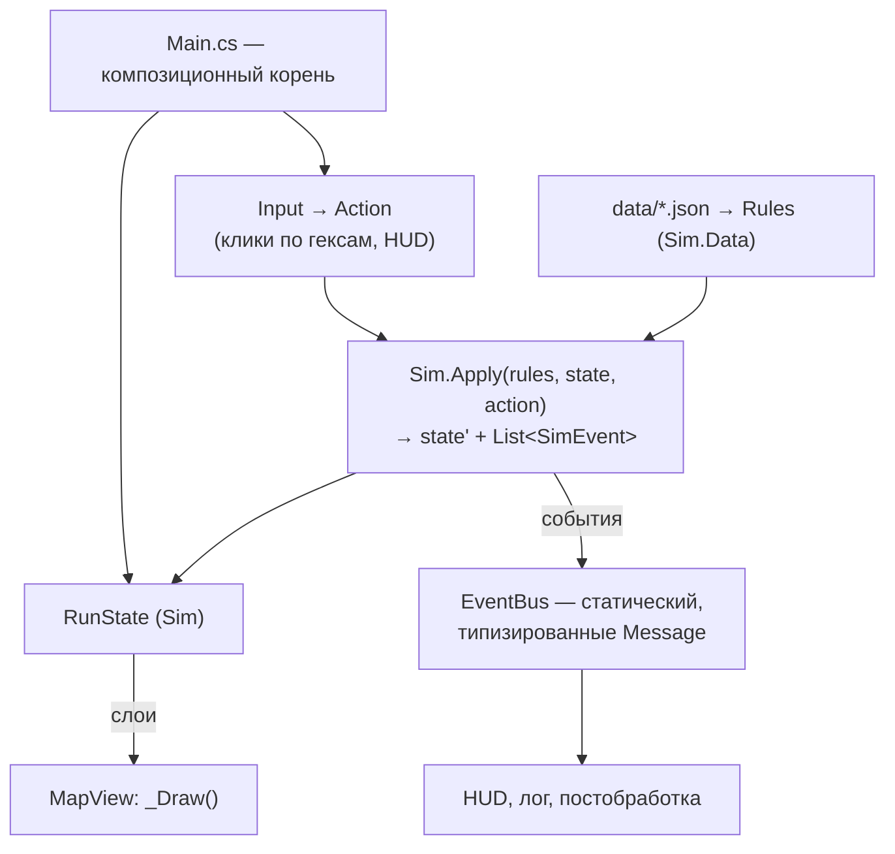

# Архитектура

> Godot 4.7 mono, C# / net10.0. Структуры данных — в `02-DATA-MODEL.md`.

## Принципы

1. **Ноль аддонов в Godot.** Весь код свой, шейдеры свои. Steam —
   через C#-библиотеку из NuGet, не через GDExtension (см. §Steam).
2. **Игровой код — C#.** Стиль — официальный Godot через `.editorconfig`
   + StyleCop, `just format`, проверка в `just test`. GDScript — только
   каркас тестового раннера.
3. **Симуляция не знает про Godot.** `sim/DevAInt.Sim` — сборка без
   ссылки на `GodotSharp`: карта, правила, генератор. Godot-проект её
   референсит. Забег играется в терминале до появления картинки.
4. **Состояние + действие → состояние.** Единственный способ изменить
   `RunState` — `Sim.Apply(rules, state, action)`. UI, авто-забеги
   и реплей — разные источники `Action`.
5. **Без autoload.** Композиция через `Main.cs`: корневой скрипт владеет
   состоянием и системами, явный порядок init, явный teardown.
6. **Данные — в JSON под `project/data/`.** Числа в коде запрещены.
7. **Детерминизм.** Всё от сида через свой `Rng` (xorshift64*), состояние
   `Rng` — часть `RunState`. В правилах только целые и простые операции
   с float; никаких `Math.Pow/Sin/Exp` и порядок-зависимых сумм по
   словарям. Это даёт реплей, сейв и ежедневный забег бесплатно.

## Сборки

```text
.editorconfig               — общий стиль C#
sim/
  DevAInt.Sim/              — чистая симуляция (classlib, без Godot)
  DevAInt.Sim.Tests/        — xUnit-тесты (`just test-sim`, секунды)
  DevAInt.Sim.Tool/         — консоль без Godot: `just map`, `just play`, позже `just balance`
project/
  DevAInt.sln               — Godot-проект + обе сборки sim/
  DevAInt.csproj            — Godot-проект, ProjectReference на Sim
  data/*.json               — таблицы правил
  core/                     — Main, EventBus, DebugOverlay, MapView, Hud, Screens
  tests/                    — Godot-раннер + тесты сцен
```

`sim/` лежит вне `project/`, потому что Godot-csproj компилирует все
`**/*.cs` под собой.

### Что из v2 остаётся и что меняется на первом уикенде

| Файл | Судьба |
|---|---|
| `Hex.cs`, `Layer.cs`, `Rng.cs`, `Search.cs`, `World.cs`, `MapResult.cs` | Без изменений (`Rng` получает доступ к состоянию для сейва) |
| `MapGen.cs` | Без изменений в алгоритме; вход — один старт, одна строка размера |
| `Data/Defs.cs`, `Data/Rules.cs` | Урезаются под `02-DATA-MODEL.md §3`, валидация обновляется |
| `data/ai.json`, `data/factions.json` | Удаляются |
| Тесты `Hex/Layer/Rng/Search/World/MapGen` | Остаются; `RulesTest` и `MapGenGenerateTest` правятся под новые данные |
| `project/core/{main,event_bus,debug_overlay}` | Без изменений |

## Схема систем



## Поток одного действия

1. Ввод формирует `Action` (`Exploit(slotIx, target)`).
2. `Sim.Check(rules, state, action)` — проверка; UI спрашивает её же
   для подсветки, `CanCapture` — для разбора при наведении.
3. `Sim.Apply` меняет состояние на месте и возвращает список `SimEvent`.
4. `Main` публикует события в `EventBus` → лог, HUD, отклик.
5. `Main` просит `MapView` перерисоваться.

Godot-слой **не содержит правил**: если что-то решается в `_Process` —
это баг архитектуры.

## EventBus

- Сообщение — подкласс `Message`; подписка по типу; подписка на базовый
  тип = слушать всё (лог, отладка).
- `EventBus.Reset()` обязателен при старте забега и в teardown
  (`NOTIFICATION_WM_CLOSE_REQUEST`): статическая шина с живыми
  подписками на выгрузке роняет процесс — проверено в v1.

## Композиция и жизненный цикл

- `Main`: `init` в порядке «данные → состояние → рендер → HUD»,
  teardown зеркально и идемпотентно (гард на повторный вызов).
- `init()`/`deinit()` вместо `_Ready`-магии: узлы, получающие
  зависимости, выключают процессинг в `_Ready` и включаются от владельца.
- Экраны (меню, старт, забег, итог) — сцены, которые `Main` создаёт
  и убирает явно; состояние забега живёт только в `RunState`.

## Сейвы и реплей

- Прогресс (открытые мутаторы, статистика) — маленький JSON в `user://`.
- Забег = сид + мутаторы + список `Action`. Сейв посреди забега —
  сериализованный `RunState` (JSON, `System.Text.Json`, конвертер
  только для `Hex`). Формат бага: «сид + действия».
- Ежедневный забег — сид из даты, тот же код.

## Тесты

- `just test-sim` — xUnit без движка: геометрия, данные, генератор,
  каждое правило на карте 5 × 5, воспроизводимость забега от сида,
  случайные легальные действия доигрывают забег без исключений.
- `just test` — `dotnet format --verify`, sim-тесты, Godot-раннер
  (`MainTest` инстанцирует `main.tscn`, экраны переключаются, шина
  сбрасывается).
- `just play <seed>` — забег в терминале: ASCII-карта, команды текстом.
  Это и инструмент отладки правил, и первый плейтест.
- `just balance` (после прототипа) — N авто-забегов простой политикой,
  таблица метрик из `03-BALANCE.md §8`.

## Steam

- **Библиотека:** `Facepunch.Steamworks` из NuGet — чистый C#, без
  GDExtension, работает с Godot mono. Проверить на Linux и Steam Deck
  на третьем месяце, до Steam-страницы; запасной вариант — GodotSteam
  (GDExtension + C#-обёртка), если Facepunch не заведётся.
- **Что используем:** инициализация с `steam_appid.txt`, ачивки,
  таблица лидеров ежедневного забега, облако для файла прогресса.
  Всё — подписчики шины, `Sim` про Steam не знает.
- **Билды:** экспорт Linux + Windows из Godot, загрузка SteamCMD
  в ветку `beta`; рецепт `just steam-build`. Steam Deck — Linux-билд
  с геймпадом.
- **Настройки** (обязательны для Steam): полный экран/окно, разрешение,
  громкость, постобработка вкл/выкл, переназначение клавиш, геймпад.

## Производительность

~250 гексов, один daemon, ход раз в несколько секунд: узких мест нет.
`_Draw` по событию, шейдер постобработки на полный экран — единственное,
что работает каждый кадр. Оптимизации не планируются.

## Заметка на потом

В `project.godot` стоит Forward Plus; для чисто 2D к экспорту
взвесить Compatibility (Steam Deck, слабые ноутбуки). Меняется
безболезненно в любой момент.
